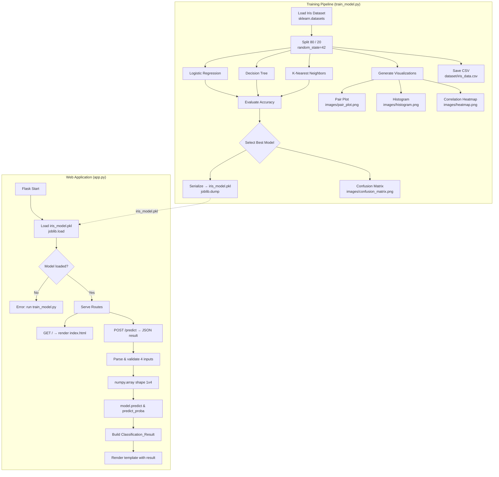
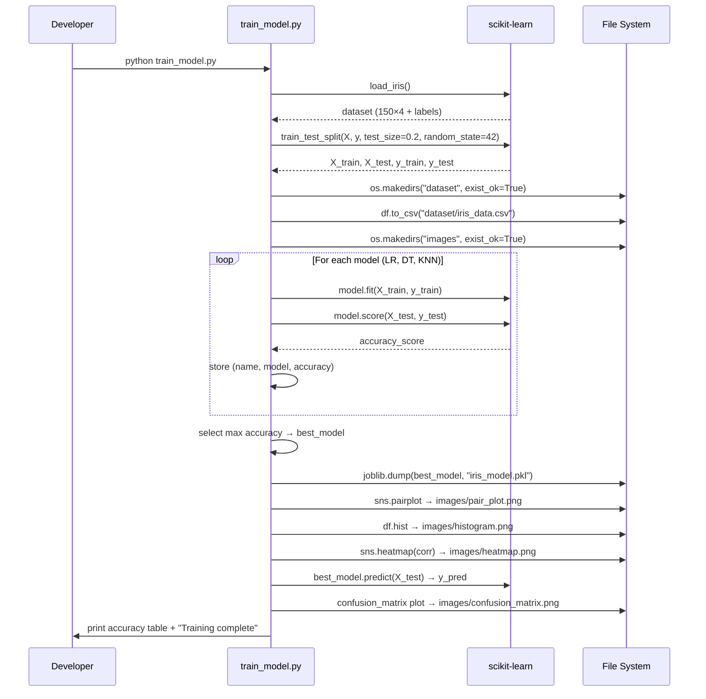
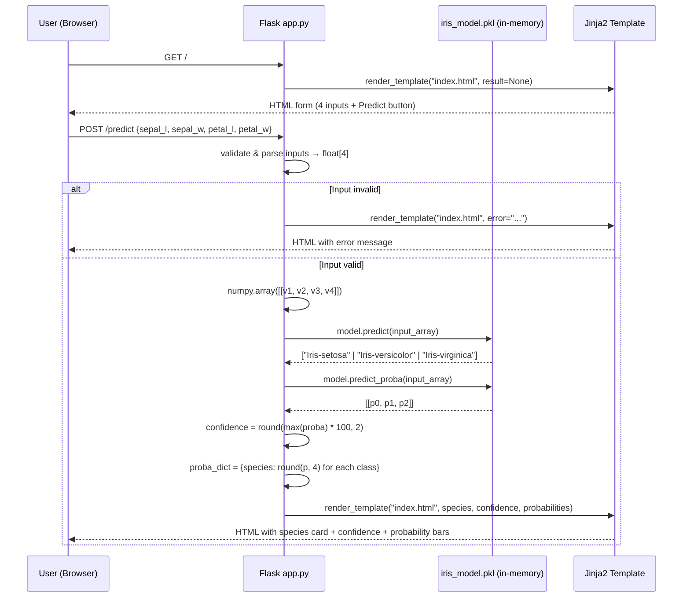

# Design Document: Iris Flower Classification ML Application

## Overview

The Iris Flower Classification ML Application is a two-stage system: an offline **model training pipeline** (`train_model.py`) and an online **Flask web application** (`app.py`). The training pipeline loads the canonical Iris dataset, trains three classifiers, selects the best performer, serialises it to disk, and generates four data-visualisation artefacts. The web application loads the serialised model at startup and exposes a two-route API — a homepage that renders an HTML form and a prediction endpoint that returns species, confidence score, and class probabilities as JSON-compatible template variables.

The design follows a deliberate simplicity-first principle: no database, no task queue, no containerisation. Everything runs on a single machine with `pip install -r requirements.txt` followed by two commands. This is intentional — the project is a self-contained educational and demonstration artefact.

**Key design decisions:**

| Decision | Choice | Rationale |
|---|---|---|
| Model selection strategy | Highest test-set accuracy among three candidates | Simple, reproducible, deterministic with `random_state=42` |
| Serialisation format | Joblib | NumPy array compatibility, faster than `pickle` for scikit-learn estimators |
| Web framework | Flask (micro) | Minimal overhead; no ORM or migrations needed |
| Front-end approach | Server-side Jinja2 templates, plain CSS | No build step; no Node.js dependency |
| Visualisation persistence | Static PNG files in `images/` | Pre-generated; no runtime Matplotlib overhead on prediction path |

---

## Architecture

The system has two independent runtime contexts that share the `iris_model.pkl` artefact as a handoff boundary.



### Sequence Diagram — Training Flow



### Sequence Diagram — Prediction Flow



---

## Components and Interfaces

### Component 1: Model_Trainer (`train_model.py`)

Responsibilities: dataset acquisition, preprocessing, model training, evaluation, serialisation, visualisation generation.

```
train_model.py
├── load_data() → (DataFrame, X, y, label_names)
├── split_data(X, y) → (X_train, X_test, y_train, y_test)
├── train_models(X_train, y_train) → List[(name, model)]
├── evaluate_models(models, X_test, y_test) → List[(name, model, accuracy)]
├── select_best(evaluated) → (name, model, accuracy)
├── save_model(model, path) → None
├── generate_pair_plot(df, label_names) → None
├── generate_histogram(df) → None
├── generate_heatmap(df) → None
├── generate_confusion_matrix(model, X_test, y_test, label_names) → None
└── main() → None   # orchestrates all steps
```

**Public interface contract:**
- `split_data` always uses `test_size=0.2, random_state=42`
- `save_model` calls `joblib.dump(model, "iris_model.pkl")`
- All `generate_*` functions call `plt.savefig(path, bbox_inches="tight")` then `plt.close()`

### Component 2: Flask_Application (`app.py`)

Responsibilities: model loading at startup, HTTP routing, input validation, prediction dispatch, template rendering.

```
app.py
├── load_model() → model | None          # called once at startup
├── GET  /                               # renders index.html (no result)
└── POST /predict                        # validates input → predict → render result
```

**Route contracts:**

| Route | Method | Input | Output |
|---|---|---|---|
| `/` | GET | — | `render_template("index.html")` |
| `/predict` | POST | form fields: `sepal_length`, `sepal_width`, `petal_length`, `petal_width` | `render_template("index.html", species=…, confidence=…, probabilities=…)` |

**Template variables passed to `index.html`:**

```python
{
    "species": str,          # e.g. "Iris-setosa"
    "confidence": float,     # e.g. 97.43  (max_proba × 100, 2dp)
    "probabilities": {       # per-class, 4dp
        "Iris-setosa":      float,
        "Iris-versicolor":  float,
        "Iris-virginica":   float,
    },
    "error": str | None      # non-None when input validation fails
}
```

### Component 3: Data Pipeline

The data pipeline is entirely contained within `train_model.py` and runs to completion each time the script executes. There is no incremental or streaming element.

```
scikit-learn load_iris()
    ↓
pandas DataFrame (150 rows × 5 cols: 4 features + species_name)
    ↓
train_test_split → X_train(120×4), X_test(30×4), y_train(120,), y_test(30,)
    ↓
[parallel] CSV export          [parallel] Model training loop
dataset/iris_data.csv          LR / DT / KNN each: fit → score
                                ↓
                           best model selected
                                ↓
                         iris_model.pkl (joblib)
```

### Component 4: Visualization Engine

Four visualisations are generated sequentially after model selection. Each function is self-contained: it creates its own figure, saves it, and closes the figure to release memory.

| Function | Library calls | Output file |
|---|---|---|
| `generate_pair_plot` | `sns.pairplot(df, hue="species")` | `images/pair_plot.png` |
| `generate_histogram` | `df.hist(bins=20, figsize=(12,8))` | `images/histogram.png` |
| `generate_heatmap` | `sns.heatmap(df.corr(), annot=True)` | `images/heatmap.png` |
| `generate_confusion_matrix` | `sklearn.metrics.ConfusionMatrixDisplay` | `images/confusion_matrix.png` |

---

## Data Models

### Iris Feature Vector

The fundamental unit of data flowing through both the training and prediction paths.

```python
# Training representation (NumPy array)
X: np.ndarray          # shape (n_samples, 4), dtype float64
# Columns:             [sepal_length, sepal_width, petal_length, petal_width]
# Range (approx):      [4.3–7.9,      2.0–4.4,    1.0–6.9,      0.1–2.5]

y: np.ndarray          # shape (n_samples,), dtype int64, values {0, 1, 2}

# Prediction representation (single sample)
input_array: np.ndarray  # shape (1, 4), dtype float64
```

### Model File Schema

```
iris_model.pkl   — joblib serialised scikit-learn estimator
                   Must implement: .predict(X) and .predict_proba(X)
                   Candidate types: LogisticRegression | DecisionTreeClassifier | KNeighborsClassifier
```

### Classification Result (template context)

```python
@dataclass
class ClassificationResult:
    species:       str               # one of SPECIES_NAMES
    confidence:    float             # range [0.0, 100.0], 2 decimal places
    probabilities: dict[str, float]  # keys = SPECIES_NAMES, values ∈ [0.0, 1.0], 4dp

SPECIES_NAMES = ["Iris-setosa", "Iris-versicolor", "Iris-virginica"]
```

### Dataset CSV Schema

```
dataset/iris_data.csv
Columns: sepal_length (float), sepal_width (float), petal_length (float),
         petal_width (float), species (str)
Rows:    150 (no header duplication, index excluded)
```

### Model Performance Record (in-memory only)

```python
ModelRecord = namedtuple("ModelRecord", ["name", "model", "accuracy"])
# accuracy: float ∈ [0.0, 1.0]
# Printed to stdout; not persisted to disk
```

### Directory / File Structure

```
iris-flower-classification/
├── app.py                     # Flask web application
├── train_model.py             # Training pipeline
├── requirements.txt           # Pinned dependencies
├── README.md                  # Project documentation
├── iris_model.pkl             # Generated artefact (gitignored)
├── .gitignore
├── LICENSE
├── dataset/
│   └── iris_data.csv          # Generated artefact
├── static/
│   └── style.css              # Global styles
├── templates/
│   └── index.html             # Jinja2 template (home + results)
├── images/
│   ├── pair_plot.png          # Generated artefact
│   ├── histogram.png          # Generated artefact
│   ├── heatmap.png            # Generated artefact
│   └── confusion_matrix.png  # Generated artefact
└── screenshots/               # Manual screenshots for README
```

---

## Correctness Properties

*A property is a characteristic or behavior that should hold true across all valid executions of a system — essentially, a formal statement about what the system should do. Properties serve as the bridge between human-readable specifications and machine-verifiable correctness guarantees.*

### Property 1: Prediction Output Shape Invariant

*For any* valid 4-element feature vector (sepal_length, sepal_width, petal_length, petal_width), the prediction endpoint SHALL return exactly one species name drawn from the set `{"Iris-setosa", "Iris-versicolor", "Iris-virginica"}`.

**Validates: Requirements 5.4**

---

### Property 2: Confidence Score Range

*For any* valid feature vector, the confidence score returned by the prediction endpoint SHALL be a floating-point number in the closed interval `[0.0, 100.0]`, rounded to two decimal places.

**Validates: Requirements 5.6, 5.7**

---

### Property 3: Probability Distribution Sums to One

*For any* valid feature vector, the sum of the three class probabilities returned by `model.predict_proba` SHALL equal `1.0` (within floating-point tolerance of ±1e-6), and each individual probability SHALL lie in `[0.0, 1.0]`.

**Validates: Requirements 5.5, 5.8**

---

### Property 4: Model Accuracy Exceeds Threshold on Test Set

*For any* execution of the training pipeline with the canonical scikit-learn Iris dataset and `random_state=42`, the accuracy of the selected best model on the held-out test set SHALL exceed `0.90`.

**Validates: Requirements 1.4, 1.5**

---

### Property 5: Visualisation Files Are Created

*For any* successful execution of `train_model.py`, all four visualisation files (`pair_plot.png`, `histogram.png`, `heatmap.png`, `confusion_matrix.png`) SHALL exist in the `images/` directory as non-empty PNG files.

**Validates: Requirements 2.2, 2.4, 2.6, 2.8**

---

### Property 6: Input Validation Rejects Non-Numeric and Missing Values

*For any* POST request to `/predict` where one or more of the four required fields is absent or non-numeric, the system SHALL return an error response and SHALL NOT invoke the model's predict method.

**Validates: Requirements 5.10**

---

### Property 7: Confidence-Probability Consistency

*For any* valid feature vector, the confidence score SHALL equal `round(max(probabilities.values()) * 100, 2)` — i.e., confidence is always derived from and consistent with the returned probability values.

**Validates: Requirements 5.6**

---

## Error Handling

### Training Pipeline Errors

| Error scenario | Handling strategy |
|---|---|
| `images/` or `dataset/` directory absent | `os.makedirs(path, exist_ok=True)` before first write — never raises |
| scikit-learn dataset unavailable | Let exception propagate; user will see a clear traceback pointing to the import |
| Joblib serialisation failure (disk full) | Let `OSError` propagate; message includes the path — actionable without wrapping |
| Matplotlib figure rendering failure | `plt.close()` in `finally` block to prevent memory leak regardless of outcome |

### Web Application Errors

| Error scenario | Handling strategy |
|---|---|
| `iris_model.pkl` not found at startup | Catch `FileNotFoundError`; set global `model = None`; render error banner on all pages |
| Missing form field in POST `/predict` | `request.form.get(field)` returns `None`; validate before conversion; render `error` variable in template |
| Non-numeric form field value | Wrap `float()` conversion in `try/except ValueError`; render `error` variable in template |
| Unexpected model prediction error | Wrap `model.predict` in `try/except Exception`; log to stderr; render generic error message |

### HTTP Status Codes

The application renders errors inside the HTML template rather than returning non-200 status codes. This keeps the UX consistent (no browser error page) and is appropriate for a single-page form application. A future REST API layer would use 400/422/500 codes.

---

## Testing Strategy

### Approach

The testing strategy uses a **dual approach**:
- **Property-based tests** with [Hypothesis](https://hypothesis.readthedocs.io/en/latest/) (Python) for the seven correctness properties above — each run generates ≥100 random inputs
- **Example-based unit tests** with `pytest` for specific scenarios, edge cases, and integration points

Property-based testing is appropriate here because:
- The prediction functions are pure (deterministic given a loaded model)
- Input space is large (4 continuous floats × arbitrary ranges)
- Properties like "probabilities sum to 1" hold universally and benefit from exhaustive random sampling
- Cost is low (all inference is in-process NumPy/scikit-learn — no external services)

### Property-Based Test Configuration

```python
# pytest.ini / pyproject.toml
[tool.pytest.ini_options]
# Hypothesis settings
# Each property test runs minimum 100 examples
```

```python
# conftest.py
from hypothesis import settings
settings.register_profile("ci", max_examples=200)
settings.register_profile("dev", max_examples=100)
```

Each property-based test MUST be tagged:
```python
# Tag format: Feature: iris-flower-classification, Property N: <property_text>
```

### Property Test Specifications

**Property 1 — Prediction Output Shape Invariant**
```python
# Feature: iris-flower-classification, Property 1: Prediction Output Shape Invariant
@given(
    sepal_l=floats(min_value=0.1, max_value=20.0),
    sepal_w=floats(min_value=0.1, max_value=20.0),
    petal_l=floats(min_value=0.1, max_value=20.0),
    petal_w=floats(min_value=0.1, max_value=20.0),
)
@settings(max_examples=100)
def test_prediction_species_is_valid(sepal_l, sepal_w, petal_l, petal_w):
    result = model.predict([[sepal_l, sepal_w, petal_l, petal_w]])
    assert result[0] in iris.target_names
```

**Property 2 — Confidence Score Range**
```python
# Feature: iris-flower-classification, Property 2: Confidence Score Range
@given(feature_vector=valid_iris_feature_vectors())
@settings(max_examples=100)
def test_confidence_in_range(feature_vector):
    proba = model.predict_proba([feature_vector])[0]
    confidence = round(float(max(proba)) * 100, 2)
    assert 0.0 <= confidence <= 100.0
    # Verify 2 decimal place rounding
    assert confidence == round(confidence, 2)
```

**Property 3 — Probability Distribution Sums to One**
```python
# Feature: iris-flower-classification, Property 3: Probability Distribution Sums to One
@given(feature_vector=valid_iris_feature_vectors())
@settings(max_examples=100)
def test_probabilities_sum_to_one(feature_vector):
    proba = model.predict_proba([feature_vector])[0]
    assert abs(sum(proba) - 1.0) < 1e-6
    assert all(0.0 <= p <= 1.0 for p in proba)
```

**Property 4 — Model Accuracy Threshold**
```python
# Feature: iris-flower-classification, Property 4: Model Accuracy Exceeds Threshold
def test_best_model_accuracy_exceeds_threshold():
    # Example-based (deterministic with random_state=42; no benefit from >1 iteration)
    X, y = load_iris(return_X_y=True)
    _, X_test, _, y_test = train_test_split(X, y, test_size=0.2, random_state=42)
    accuracy = model.score(X_test, y_test)
    assert accuracy > 0.90
```

**Property 5 — Visualisation Files Created**
```python
# Feature: iris-flower-classification, Property 5: Visualisation Files Are Created
def test_visualization_files_exist_and_are_non_empty():
    expected = ["pair_plot.png", "histogram.png", "heatmap.png", "confusion_matrix.png"]
    for fname in expected:
        path = Path("images") / fname
        assert path.exists(), f"{fname} not found"
        assert path.stat().st_size > 0, f"{fname} is empty"
```

**Property 6 — Input Validation**
```python
# Feature: iris-flower-classification, Property 6: Input Validation Rejects Invalid
@given(
    bad_value=one_of(text(), none(), just(""), just("abc"))
)
@settings(max_examples=100)
def test_invalid_input_returns_error_not_prediction(client, bad_value):
    response = client.post("/predict", data={
        "sepal_length": bad_value, "sepal_width": "3.0",
        "petal_length": "1.5", "petal_width": "0.2"
    })
    assert b"error" in response.data.lower()
```

**Property 7 — Confidence-Probability Consistency**
```python
# Feature: iris-flower-classification, Property 7: Confidence-Probability Consistency
@given(feature_vector=valid_iris_feature_vectors())
@settings(max_examples=100)
def test_confidence_equals_max_probability_times_100(feature_vector):
    proba = model.predict_proba([feature_vector])[0]
    expected_confidence = round(float(max(proba)) * 100, 2)
    # Simulate app.py calculation
    confidence = round(float(max(proba)) * 100, 2)
    assert confidence == expected_confidence
```

### Example-Based Unit Tests

| Test | What it verifies |
|---|---|
| `test_model_file_exists` | `iris_model.pkl` created after training |
| `test_csv_created` | `dataset/iris_data.csv` exists with 150 rows |
| `test_home_route_status` | GET `/` returns 200 |
| `test_predict_setosa` | POST `/predict` with canonical Setosa values returns "Iris-setosa" |
| `test_predict_virginica` | POST `/predict` with canonical Virginica values returns "Iris-virginica" |
| `test_missing_field_error` | POST `/predict` with one field omitted returns error |
| `test_non_numeric_error` | POST `/predict` with `"abc"` in a field returns error |
| `test_model_not_found_error` | Starting app with no pkl renders error banner |

### Integration Tests

| Test | What it verifies |
|---|---|
| `test_full_training_pipeline` | Running `train_model.py` end-to-end creates all expected files |
| `test_app_loads_trained_model` | App starts successfully after training run |
| `test_prediction_roundtrip` | POST to `/predict` with valid inputs returns 200 with result in HTML |

### Test Stack

- **Test runner**: `pytest`
- **Property-based testing**: `hypothesis` (≥6.x)
- **Flask test client**: `flask.testing.FlaskClient` (built-in)
- **Fixtures**: `conftest.py` provides loaded model fixture and test Flask client
